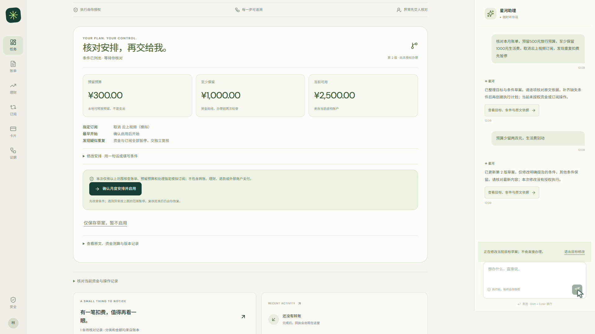
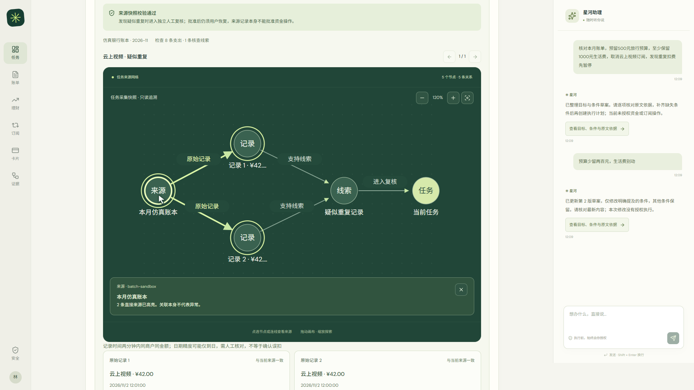
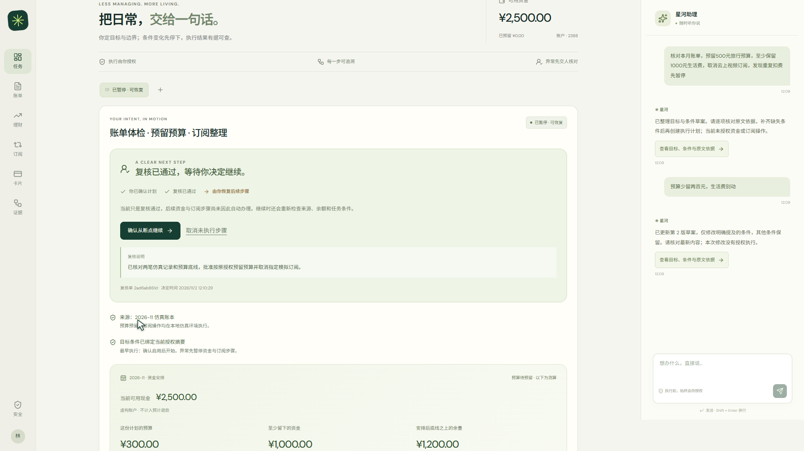
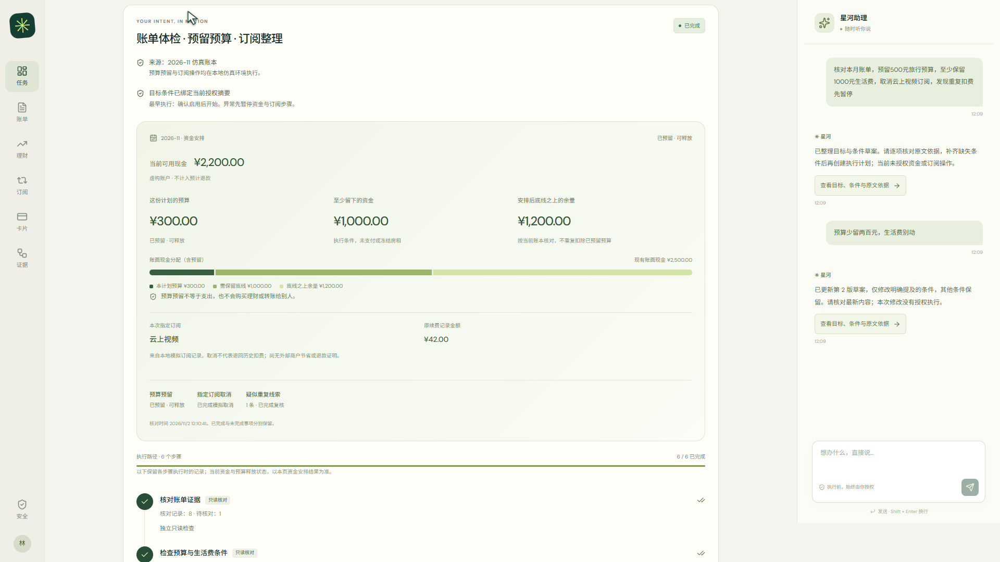
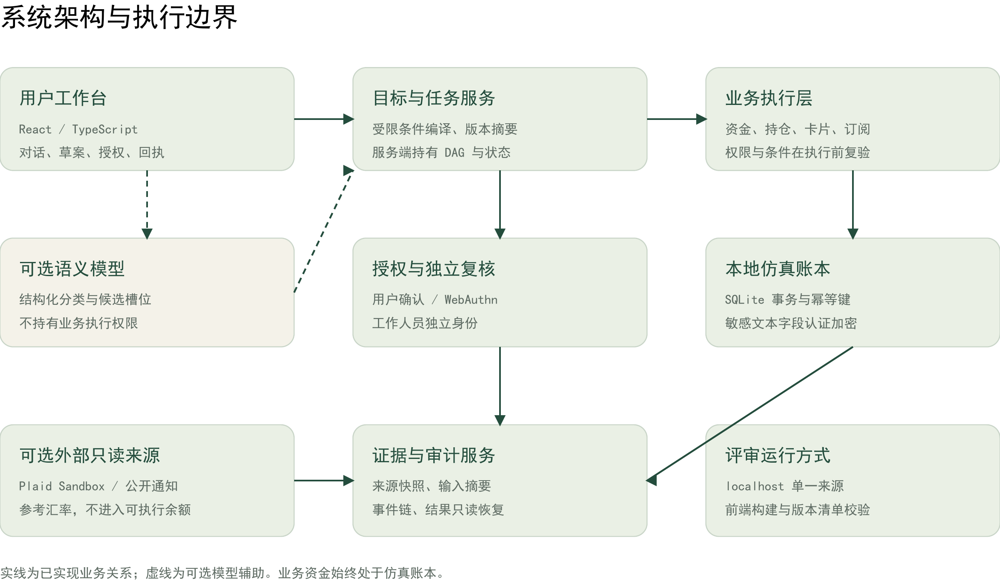

<p align="center">
  
</p>

<h1 align="center">星河——可控执行、全程可追溯的银行 AI 智能体</h1>
<p align="center">2026 深圳国际金融科技创新大赛 · 人工智能赛道</p>
<p align="center">
  <a href="#从一个目标到完整办理">产品体验</a> ·
  <a href="#让托付成立的关键设计">核心设计</a> ·
  <a href="#快速体验">快速体验</a> ·
  <a href="docs/submission/01_技术文档.pdf">技术文档</a> ·
  <a href="docs/submission/04_安全自评报告.pdf">安全自评</a>
</p>

## 让目标，安心抵达。

用户关心的是一件事能否办妥。一次月度资金安排，可能同时涉及核对账单、预留预算和整理订阅，还需要始终保留生活费底线。星河让用户用自然语言交代目标，将这些要求整理为可核对的计划，并在获得相应授权后推进办理。

这份托付始终有明确边界：修改预算时保留其他条件，出现异常时暂停后续步骤，恢复办理时重新检查来源和余额。每一步的依据与结果都能回到业务记录核验。**用户交代目标，星河负责把条件带到执行，把结果留在账本。**

当前原型通过本地仿真账本运行完整业务链路；Plaid Sandbox 作为独立只读来源接入。下方页面均来自实际运行的仿真系统，封面为产品理念的艺术表达。

## 从一个目标，到完整办理

> “检查这个月的账单，预留 500 元预算，保留 1,000 元生活费，再整理指定订阅。”

用户随后说“预算少留两百元”，系统将预算更新为 300 元，并保持生活费底线与订阅范围。核查发现待复核线索时，任务停在对应节点；复核员记录决定，用户回到原任务继续办理，最终查看预算与订阅各自的实际结果。

| 过程 | 用户得到什么 |
|---|---|
| 表达与修改目标 | 一份可核对的草案，清楚呈现金额、资金底线与操作范围 |
| 核查与分级授权 | 查看来源依据，按具体操作完成确认或设备验证 |
| 异常交接与恢复 | 知道为何暂停、由谁复核，以及下一步在哪里 |
| 办理与结果核验 | 查看账本回执；可释放的预留与已完成的订阅操作分别保留 |

<p align="center"><br /><sub>目标核对 · 先看清资金安排，再决定是否办理</sub></p>

<table>
  <tr>
    <td width="50%"></td>
    <td width="50%"></td>
  </tr>
  <tr>
    <td align="center"><sub>证据网络 · 沿判断依据回到来源</sub></td>
    <td align="center"><sub>人工复核 · 批准后由用户决定何时继续</sub></td>
  </tr>
</table>

<p align="center"><br /><sub>结果核验 · 每项操作都有明确状态</sub></p>

## 让托付成立的关键设计

### 条件计划：把用户的边界带到执行

自然语言需求被整理为带版本的条件计划。金额变化只更新相应字段，未变的资金底线继续生效；无法核验的前提先澄清，明确禁止的操作保留为约束。授权绑定计划摘要，旧版本的确认无法直接启用新安排。

### 证据绑定：让每次授权有具体依据

账单线索可以沿证据网络追溯到原始记录。预览保存来源快照，办理前再检查当前证据与业务条件；来源变化或失效时停止执行。模型辅助理解需求，权限判断与业务提交由服务端完成。

### 事实恢复：中断后从已发生的状态继续

任务按有序依赖图推进，节点状态持久保存。响应丢失时先查询原操作，已完成的事项返回原回执；重试沿用稳定幂等键。异常复核形成独立决定，用户恢复后重新校验条件。可释放预算与已经完成的订阅取消分别处理，恢复过程保留真实业务事实。

## 一套执行机制，贯通多种银行业务

| 场景 | 已实现能力 | 执行控制 |
|---|---|---|
| 智能转账 | 识别联系人与金额，生成预览，查询与恢复结果 | 日累计金额与关联风险决定授权等级 |
| 账单分析 | 消费聚合、疑似重复扣费核查、来源追溯 | 分析基于来源记录，异常线索进入核查 |
| 模拟理财 | 风险测评、产品对比及模拟申赎 | 复验适当性与测评版本，办理需强验证 |
| 卡片管理 | 冻结、解冻及挂失 | 解冻和挂失需设备强验证 |
| 模拟订阅 | 查询并取消用户指定的模拟订阅 | 明确确认后办理，限定本地模拟记录 |
| 月度安排 | 连接账单核查、预算预留和订阅整理 | 资金底线贯穿全程，异常暂停后可交接恢复 |

## 安全落实在业务执行端

**绿色查询自动执行，黄色操作明确确认，红色操作设备强验证。** 小额转账按日累计不超过 1,000 元执行黄色策略，超过阈值或命中升级条件进入红色验证；业务风险拦截独立生效。WebAuthn 校验绑定具体操作，执行前复验账户归属、授权有效期和当前条件。

敏感字段加密、角色隔离与完整审计共同支撑执行过程。模型通过固定工具范围参与任务，提示词无法扩大权限；连续失败或可疑行为触发限制与安全暂停。完整威胁边界与实现说明见 [安全自评报告](docs/submission/04_安全自评报告.pdf)。

## 架构围绕可信办理组织

React 工作台承载对话、计划核对和证据展示；FastAPI 服务负责条件编译与执行控制；SQLite 保存业务状态及账本事实。金额变动、业务状态和授权消费在事务边界内提交，外部只读来源保持独立。



| 层级 | 主要实现 |
|---|---|
| 交互体验 | React · TypeScript · Vite · 证据网络展示 |
| 任务编排 | 条件计划编译 · 版本摘要 · 固定依赖 DAG · 持久状态 |
| 业务执行 | FastAPI · 权限策略 · WebAuthn · 幂等事务 |
| 数据依据 | SQLite · 字段加密 · 来源快照 · 操作审计 |

## 可复查的验证证据

下列结果对应 **2026-11-02 归档版本**，分别验证业务边界、固定表达理解与本机交付运行。

| 验证范围 | 归档结果 | 覆盖内容 |
|---|---:|---|
| 后端内部回归 | **271 / 271** | 权限判断、条件检查、事务一致性与失败恢复 |
| 固定合成意图 | **24 / 24** | 已配置语义模型下的固定意图集合 |
| 解压运行检查 | **20 / 20** | 独立目录启动与检查，复用既有 Python 环境 |

[测试说明](TESTING.md) 保存执行入口及适用条件，并列明开发挑战首轮结果、同集回归和 BANKING77 选定子集的评测记录。独立新题评测与真实用户研究单独登记；上述数据为内部技术验证。

## 快速体验

推荐 **Windows + Python 3.13 + Chrome / Edge**。仓库包含前端生产构建，首次体验无需安装 Node.js。

```powershell
py -3.13 -m venv .venv
.\.venv\Scripts\python.exe -m pip install -r requirements.lock.txt
.\.venv\Scripts\python.exe -m scripts.init_banking_demo
.\.venv\Scripts\python.exe -m scripts.launch_banking --check
.\.venv\Scripts\python.exe -m scripts.launch_banking --port 5173
```

打开 **http://localhost:5173/banking**，从月度安排开始体验。初始化会创建虚构账户与本机演示配置；设备验证使用与配置匹配的 localhost 来源。

默认以规则模式运行。启用语义模型或连接 Plaid Sandbox 时，在本机配置相应凭据；人工复核员登录和设备绑定步骤见 [部署指南](docs/DEPLOYMENT.md)。密钥仅保存在本机。

## 深入了解

| 资料 | 阅读内容 |
|---|---|
| [技术文档](docs/submission/01_技术文档.pdf) | 系统架构、核心算法、接口及赛题能力映射 |
| [安全自评](docs/submission/04_安全自评报告.pdf) | 权限实现、威胁模型及已知风险 |
| [部署指南](docs/DEPLOYMENT.md) | 环境初始化、可选接口、复核员身份与设备验证 |
| [验证与测试](TESTING.md) | 归档结果、复现命令及评测口径 |
| [原创贡献与组件](THIRD_PARTY.md) | 原创模块、开源依赖及数据和素材来源 |
| [后续验证计划](docs/evidence/REMEDIATION_TRACKER.md) | 待验收事项与状态记录 |

```text
backend/           银行业务、条件计划、设备授权与测试
frontend/          React 源码、生产构建与构建指纹
scripts/           初始化、完整性检查及本地运行工具
docs/assets/       产品概念主视觉、真实页面与机制图
docs/examples/     可公开的合成账单样例
docs/submission/   参赛技术文档与安全自评
docs/evidence/     原始验收说明与结果
```

---

本仓库提供竞赛评审所需的源代码与复现材料。原创部分权利归各自权利人所有，授权范围见 [LICENSE](LICENSE)；第三方组件遵循各自许可证，详见 [依赖声明](THIRD_PARTY_NOTICES.txt)。主视觉由 AI 生成，其中实体造型用于表达受控执行的产品理念；软件页面截图来自实际仿真系统。
