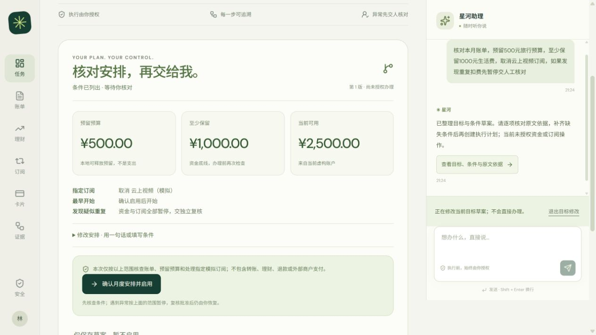

<p align="center"></p>

<h1 align="center">星河 · STARBANK</h1>
<p align="center"><strong>可控执行、全程可追溯的银行 AI 智能体</strong></p>
<p align="center">2026 深圳国际金融科技创新大赛 · 人工智能赛道参赛项目</p>

<p align="center"><a href="docs/submission/01_技术文档.pdf">技术文档</a> · <a href="docs/submission/04_安全自评报告.pdf">安全自评</a> · <a href="docs/DEPLOYMENT.md">部署指南</a> · <a href="TESTING.md">验证与测试</a></p>

## 把目标变成有边界的办理流程

数字银行的复杂需求经常跨越多个功能入口。星河让用户直接表达资金安排目标，由系统生成可核对的任务计划，并把资金底线和执行条件保留到办理阶段。用户可以通过对话修改安排，系统按最新版本重新核验；发现异常则暂停，经独立复核后仍由用户决定是否恢复。

项目的核心是从需求理解到业务执行的完整衔接。模型辅助解释需求，服务端掌握执行权；每次办理都关联明确授权和来源证据，结果以已保存的业务记录为准。

## 一条贯通的主流程

```text
表达目标 → 核对与修改草案 → 明确授权 → 核查账单与资金条件
                                      ↓ 发现异常
                           独立复核 → 用户主动恢复
                                      ↓
                           预留预算 → 处理指定订阅 → 核验结果
```

预留预算不是支出。复核批准不会自动动账。预算释放不会把已完成的订阅取消伪装成撤回成功。



## 关键设计

### 条件贯穿规划与执行

预算金额和生活费底线绑定计划版本。多轮修改保持未变条件；未知前提阻止启用，旧摘要不能授权新版本。“不得取消订阅”保留为禁止要求，系统无法核验的到账或他人同意前提不会被静默删除。

### 权限在业务端落实

查询自动处理，黄色操作要求明确确认，红色操作绑定 WebAuthn 设备验证。执行前再次检查归属、有效期与业务条件。解冻和挂失要求强验证，旧的低权限解冻预览同样被拒绝。

### 中断后先核查原结果

同一操作使用稳定幂等键。资金、持仓、业务状态和授权在事务中提交；发生失败整体回滚。响应丢失后先只读恢复，已完成的操作返回原结果，避免重复办理。


## 场景覆盖

| 场景 | 可演示能力 | 授权边界 |
|---|---|---|
| 智能转账 | 联系人和金额理解，预览与结果恢复 | 按日累计及风险升级，红色需设备验证 |
| 账单分析 | 本月消费聚合与疑似重复扣费核查 | 读取来源记录，不把提示当退款认定 |
| 模拟理财 | 风险测评、产品对比及申赎闭环 | 适当性与测评版本复验，红色办理 |
| 卡片管理 | 冻结、解冻及挂失 | 解冻和挂失需强验证 |
| 订阅管理 | 明确确认后查询及取消指定模拟订阅 | 不代表外部真实商户取消能力 |
| 月度安排 | 预算底线、异常复核及用户恢复 | 可释放预留，已完成事实分别保留 |

## 证据与验证

| 验证 | 归档结果 | 解释 |
|---|---:|---|
| 后端内部回归 | 271 / 271 | 已定义业务与安全断言 |
| 固定合成意图 | 24 / 24 | 本机配置模型下的固定集合 |
| 解压运行检查 | 20 / 20 | 独立目录运行，复用现有 Python 环境 |
| 月度挑战首轮 → 开发回归 | 21 / 26 → 26 / 26 | 同集回归不改称未见成绩 |
| AI 模拟专家首轮 → 开发回归 | 14 / 24 → 24 / 24 | AI 参与开发，不是独立专家或真实用户 |
| 外部英文路由压力测试 | 22 / 40 | BANKING77 四类子集，不是完整榜单 |

结果日期为 2026-11-02，详细断言和首轮失败随仓库保存。真实用户样本为 0；没有把开发者走查称为人类效率收益。原型资金为仿真，Plaid Sandbox 独立只读展示。参见 [测试说明](TESTING.md) 和 [安全自评](docs/submission/04_安全自评报告.pdf)。

## 快速启动

推荐 Python 3.13 与 Windows，前端已构建，无需 Node 即可启动评审页面。

```powershell
py -3.13 -m venv .venv
.\.venv\Scripts\python.exe -m pip install -r requirements.lock.txt
.\.venv\Scripts\python.exe -m scripts.init_banking_demo
.\.venv\Scripts\python.exe -m scripts.launch_banking --check
.\.venv\Scripts\python.exe -m scripts.launch_banking --port 5173
```

在 Chrome/Edge 打开 **http://localhost:5173/banking**。使用 localhost 以匹配通行密钥来源。默认关闭外部模型，使用新建虚构会话；如需语义模型和 Plaid Sandbox，请按 [部署指南](docs/DEPLOYMENT.md) 在本机配置。不要把密钥粘贴到聊天或 GitHub。

## 资料导航

- [技术文档 PDF](docs/submission/01_技术文档.pdf)：架构、算法、接口、测试和赛题映射。
- [安全自评 PDF](docs/submission/04_安全自评报告.pdf)：权限实现、威胁边界和已知风险。
- [部署指南](docs/DEPLOYMENT.md)：环境初始化、工作人员登录、设备验证和故障处理。
- [测试说明](TESTING.md)：本机回归、模型口径及可复查证据。
- [组件与原创边界](THIRD_PARTY.md)：原创实现、可选依赖及素材来源。
- [整改台账](docs/evidence/REMEDIATION_TRACKER.md)：保留尚待验证的边界。

## 目录

```text
backend/           银行业务、受限规划、设备授权与测试
frontend/          React 源码、生产构建与构建指纹
scripts/           初始化、完整性检查及本地运行工具
docs/assets/       实际页面截图与架构图
docs/examples/     可公开的合成账单样例
docs/submission/   参赛技术文档和安全自评
docs/evidence/     原始验收说明与结果
```

## 使用与权利

本仓库为竞赛评审提供源代码与复现材料。原创部分权利归各自权利人所有，未自动授予商业使用或再许可权；第三方组件适用各自许可证，参见 [权利说明](LICENSE) 和 [依赖声明](THIRD_PARTY_NOTICES.txt)。封面为 AI 生成的概念视觉，架构图按代码绘制，页面图片来自实际仿真系统。
