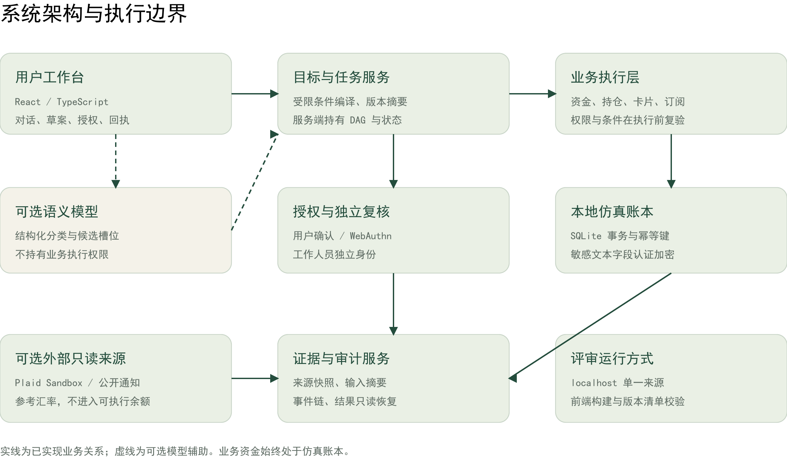
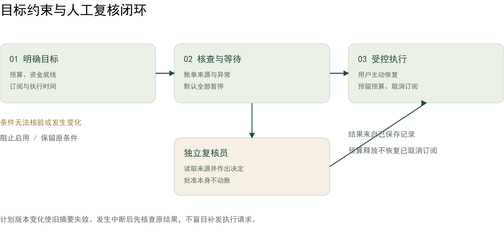
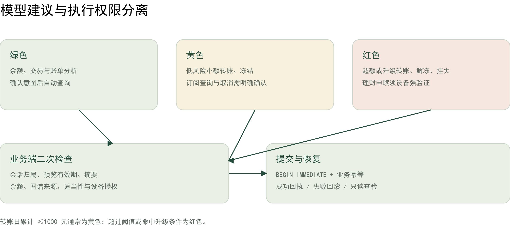
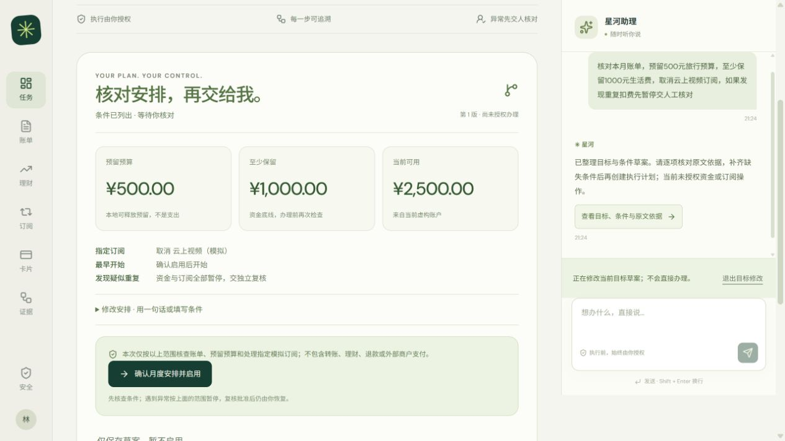

# 星河银行 AI 智能体技术文档

可控执行、全程可追溯的银行 AI 智能体

## 项目摘要

星河面向数字银行中跨功能办理复杂需求的问题，将自然语言需求转化为受条件约束的任务流程。系统把用户的资金底线与执行条件绑定到计划版本，在明确授权后推进办理；出现异常时停止执行，经独立复核后由用户决定恢复。来源快照和业务记录贯穿任务全程，使每次办理能够说明依据并核验结果。

本项目以月度资金安排为主场景，覆盖转账、账单分析及模拟理财等核心业务。原型采用前后端分层设计，业务资金位于隔离仿真账本，设备授权采用 WebAuthn 签名验证。

| 内部回归 | 固定意图 | 发布运行检查 |
| --- | --- | --- |
| 271 / 271 | 24 / 24 | 20 / 20 |

版本依据：2026-11-02 已归档验收；文档编制日期：2026-11-02。本文说明实现与可复现证据，配套安全自评报告说明权限边界和已知风险。

# 系统架构与职责分离

架构将对话理解与业务授权分离。模型可以辅助生成结构化候选，能否办理由服务端确定性规则决定；用户输入不能直接指定工具、修改任务依赖或提交可执行代码。

| 层次 | 实现位置 | 职责 |
| --- | --- | --- |
| 交互 | frontend/src/banking/ | 对话、计划核对、复核交接和结果展示 |
| 业务 | backend/banking*.py | 条件编译、状态推进及资金控制 |
| 模型辅助 | banking_nlu.py | 类型约束输出，不授予资金权限 |
| 数据与证据 | banking_storage.py 等 | 字段加密、来源快照与审计 |
| 交付 | scripts/launch_banking.py | 本地运行及构建指纹校验 |

银行主流程使用 SQLite 持久化。原企业关系调查能力保留为扩展模块；它不是本地资金账本，也不应把公开企业关系或图谱样例称为真实账户风控。

# 需求理解与条件编译

## 从自然语言到可核对草案

对话入口先判断任务范围，再提取明确金额、资金底线、指定订阅和时间条件。月度组合由受限编译器处理，生成带版本号与摘要的持久草案。存在歧义时补充询问，存在未支持条件时阻止编译，不以默认值替代用户要求。

| 字段 | 含义 | 校验 |
| --- | --- | --- |
| amount | 本次人民币预算 | 十进制解析后按整数分处理 |
| minimum_balance | 办理后需保留资金 | 缺失时询问，不自行降低 |
| subscription_id | 唯一指定有效订阅 | 不猜测或批量选择 |
| not_before | 最早执行时间 | 未来七天内且不超会话期限 |
| risk_policy | 异常时的办理范围 | 改变范围需要明确确认 |

## 多轮修改保留未变条件

每次修改引用当前草案摘要，并原子更新版本。相对金额修改基于最新已明确值计算；未知子句或冲突修改导致整次回滚。更改预算不会擦除原始限制，旧版本摘要不能用于启用新安排。

## 无法核验的条件先停止

“不得取消订阅”被保留为禁止要求；“仅当工资到账”或“须经家人同意”不在现有工具可核验范围内，因此阻止启用并保留原文。后置否定或不明确表达要求用户重新说明，避免将误解后的草案变成操作授权。

对应实现：banking_goal_planner.py。可选模型在 8 秒超时、无自动重试的限制下返回结构化候选；模型故障回退到确定性规则，不宣称任意语言条件均已覆盖。

# 任务规划与异常交接

任务链按账单核查、异常复核、资金条件检查、预算预留、指定订阅处理和通知推进。节点状态及证据持久保存，中断后从记录核查进度，避免靠对话文本推断成功。

## 默认暂停与明确例外

默认策略在疑似异常时暂停资金与订阅步骤。用户可明确选择允许本地可释放预算先预留，但订阅取消仍等待复核。策略变化更新摘要，并要求显式确认适用范围。

## 批准与继续办理分别授权

复核员使用独立凭据读取任务来源并填写决定。批准不会自动动账或恢复任务；用户核对后主动继续。拒绝后客户不能自行越过复核，来源发生变化时需要重新核查。

## 补偿遵循业务事实

未完成步骤可停止；已预留预算可释放。已经完成的订阅取消不会被伪装成可自动撤回操作，部分完成状态分别保留，防止“回退成功”掩盖不可逆结果。

# 权限与设备授权

绿色查询无需二次确认。低风险转账按日累计阈值判定黄色或红色，关联证据或行为条件可以升级风险。冻结为黄色，解冻和挂失为红色；模拟理财申购及赎回均按红色办理。订阅查询与取消要求明确确认。

## 操作摘要绑定

预览摘要绑定具体操作内容。确认、设备授权及执行均核对原记录，执行前重新校验资金、日累计和来源版本。旧的低权限解冻预览被拒绝，避免策略升级后继续使用遗留授权。

## WebAuthn 验证路径

服务端校验挑战、来源、RP 与签名，并要求用户验证标志。验证结果绑定操作标识和摘要，授权在同一事务内消费。私钥由认证器管理，系统不接收 PIN 或生物识别模板。

当前设备绑定属于虚构会话，不代表实名 KYC 或认证器硬件防伪。默认发布配置启用 passkey；演示验证码只在明确的开发演示模式开放。

# 事务执行与结果恢复

## 提交以账本为准

金额以整数分落库。执行使用 BEGIN IMMEDIATE 事务，将资金变动、业务状态、授权消费与完成审计置于原子提交边界。失败触发回滚；成功回执来自已保存记录。

读取归属操作 → 核对状态与有效期
同操作 + 同幂等键已完成 → 返回原结果
重查权限、设备授权与当前业务条件
写业务状态 + 更新资金/持仓 + 记录审计
提交事务 → 返回结果；异常 → 整体回滚

## 响应丢失不等于办理失败

浏览器保留与当前会话绑定的操作恢复索引。刷新或响应中断后先只读查验原操作，再决定是否继续；已完成时返回原回执，不补发资金请求。过期、账户锁定、待验证和未知状态提供不同指引。

| 业务 | 本轮故障覆盖 | 核验结果 |
| --- | --- | --- |
| 转账 | 响应丢失、并发、过期、跨会话、回滚 | 只产生一次有效扣账 |
| 卡片冻结 | 同上，另测解冻强验证及旧授权 | 状态更新与审计一致 |
| 模拟申购 | 同上，交易绑定设备授权 | 资金与持仓共同回滚 |
| 取消订阅 | 同上，状态变化后重新检查 | 原键重试不重复取消 |

内部对账将现金、持仓与有效预留分别和业务记录核对；不自动修正差异。本轮不等于物理断电、所有赎回边界或跨机器灾备验证。

# 来源证据与外部数据

## 任务证据与实际输入绑定

月度证据图仅引用本任务实际核查的记录，保留原始交易标识、导入批次及文件摘要。办理前重新计算输入摘要；来源变化、缺失或完整性不符时停止后续资金与订阅步骤。

## 图谱的作用

收款关联图谱用于解释配置的共享设备或快速流转信号，并可改变转账授权级别。事实语句由已核实快照编译，模型只可组织受限的已知结论。图谱样例与公开资料不是银行账户黑名单。

| 来源 | 用途 | 执行边界 |
| --- | --- | --- |
| 本地合成账本 | 余额、账单与业务闭环 | 可执行虚构资金 |
| 用户确认的账单导入 | 本月支出核查与来源关联 | 导入不会增加余额 |
| Plaid Sandbox | 第三方账户与交易只读展示 | 独立展示，不参与本地转账 |
| 公开通知 | 来源索引与防骗信息 | 未命中不代表安全 |
| 参考汇率 | 预算试算与人民币预留 | 不进行换汇或境外支付 |

缓存除校验摘要，还检查汇率语义和时间。外部限流、超时或格式异常保留最近成功快照与游标，返回明确不可用状态，不编造替代数据。

# 前端主流程与信息呈现

确认页优先展示预留预算、资金底线与可用现金，再说明订阅动作和异常策略。自然语言修改、原文依据及版本记录按需展开，使授权范围在确认前可见。

遇到无法核验的条件，页面保留原文并解释停止原因，明确草案没有办理副作用。重写入口把完整需求带回输入框，不自动删除限制或发送新请求。

异常交接提供定位到当前任务的复核入口。批准后只保留明确的客户恢复入口；操作恢复面板先核查原记录，账户锁定时不打开可办理对话框。卡片和订阅结果不再误报为资金入账。

本轮证据来自开发者浏览器走查。真实用户样本为 0，手机、键盘和大字体的全面可用性尚需独立验收。

# 接口契约与复现入口

| 方法和接口 | 作用 | 关键约束 |
| --- | --- | --- |
| POST /session | 新建虚构会话 | 返回令牌，不代表实名账户 |
| POST /conversation/messages | 解释需求、生成或修改草案 | 对话本身不办理 |
| POST /goal-plans/prepare | 整理目标约束 | READY / NEEDS_INPUT / BLOCKED |
| POST /goal-plans/{id}/refine | 修改当前草案 | 当前 digest，整次原子更新 |
| POST /goal-plans/{id}/activate | 核对后启用 | 明确确认及最新摘要 |
| POST /transfers/{id}/execute | 执行转账 | 原业务授权及 idempotency_key |
| POST /auth/authorize/verify | 设备验证 | 签名与具体操作摘要绑定 |
| POST /operator/login | 工作人员短时登录 | 独立凭据及角色权限 |
| GET /execution/{kind}/{id} | 只读恢复结果 | expected_digest 及会话归属 |
| GET /execution-reconciliation | 内部账本核对 | 只读，不自动修账 |

接口基路径为 /api/banking；理财位于 /api/banking/wealth。客户通过 X-Banking-Session 标识当前虚构会话，工作人员使用独立 X-Banking-Operator。请由浏览器或本地环境管理凭据，不把令牌放进 URL 或提交文件。

完整交互字段以随包 Pydantic 模型为准；API 文档可在本机 /docs 查看。归属不符返回 404，摘要或业务状态冲突通常为 409，校验失败为 422，账户锁定为 423。

# 评测结果与证据口径

评测分别回答已定义业务是否可靠、陌生表达会在哪里失败、交付文件能否运行。以下记录保留测试来源及首轮失败，不用开发重测替代独立评测。

| 证据 | 结果 | 适用范围 |
| --- | --- | --- |
| 内部后端回归 | 271 / 271 | 预定义方法覆盖业务与安全边界 |
| 固定合成意图 | 24 / 24 | 配置模型下的固定路由集合 |
| 解压运行检查 | 20 / 20 | 复用本机环境的独立目录运行 |
| 月度新任务首轮 | 21 / 26 | 开发者编写，不是独立盲测 |
| 同集开发回归 | 26 / 26 | 修复后，不能重新称为未见任务 |
| AI 专家模拟首轮 | 14 / 24 | 同一 AI 参与开发与执行 |
| 同集开发回归 | 24 / 24 | 保留禁止要求与前置条件修复 |
| 外部英文四类路由 | 22 / 40 | BANKING77 子集，不是完整榜单 |

提交前补测月初、跨年与闰日的合成账单生成，保证样例不位于未来，且不会因日期压缩额外产生重复扣费。

首次结果存于对应 first_run.json，后续结果另存时间戳。外部英文路由用于压力诊断，不等价于中文端到端成功率。真实用户样本数为 0；开发者走查不产生人类效率或满意度结论。

可复查文件：backend/eval/reports/banking_release_v1.json；monthly_challenge_v1/first_run.json；ai_expert_v1/first_run.json；banking77_live_v1.json。完整执行命令见部署文档与 TESTING.md。

# 部署与赛题要求映射

评审包前端已构建，后端以单一 localhost 服务提供页面和接口。默认关闭外部模型并启用设备验证，不依赖真实银行凭据；核心流程可使用合成账本演示。

py -3.13 -m venv .venv
.\.venv\Scripts\python.exe -m pip install -r requirements.lock.txt
.\.venv\Scripts\python.exe -m scripts.init_banking_demo
.\.venv\Scripts\python.exe -m scripts.launch_banking --check
.\.venv\Scripts\python.exe -m scripts.launch_banking --port 5173

使用 Chrome/Edge 打开 http://localhost:5173/banking。初始化生成新加密密钥和本机复核凭据，不覆盖已有配置。工作人员凭据存于 backend/data/private/local-reviewer.token，由演示管理员保管。不要直接复制 .env.example 代替初始化。

| 赛题要求 | 本项目对应实现 |
| --- | --- |
| 至少三类银行场景 | 智能转账、账单分析、模拟理财；另有卡片和订阅 |
| 权限分级 | 自动查询、明确确认、操作绑定设备验证 |
| 幻觉与注入防护 | 结构化候选、服务端规则、真实记录驱动结果 |
| 审计与异常熔断 | 会话事件链、验证锁定、异常暂停与独立复核 |
| 任务 DAG 与人工接管 | 服务端固定依赖、持久状态、客户恢复及部分停止 |
| 受限执行环境 | 不执行模型生成代码，工具范围由服务端固定 |

原创贡献集中于条件编译、授权绑定、任务证据与异常恢复的业务整合。React、FastAPI、WebAuthn 等第三方组件遵守各自许可，随包保留依赖版本与许可文本。冷安装、跨系统及生产银行部署另行验收；本文没有将其列为已完成能力。
