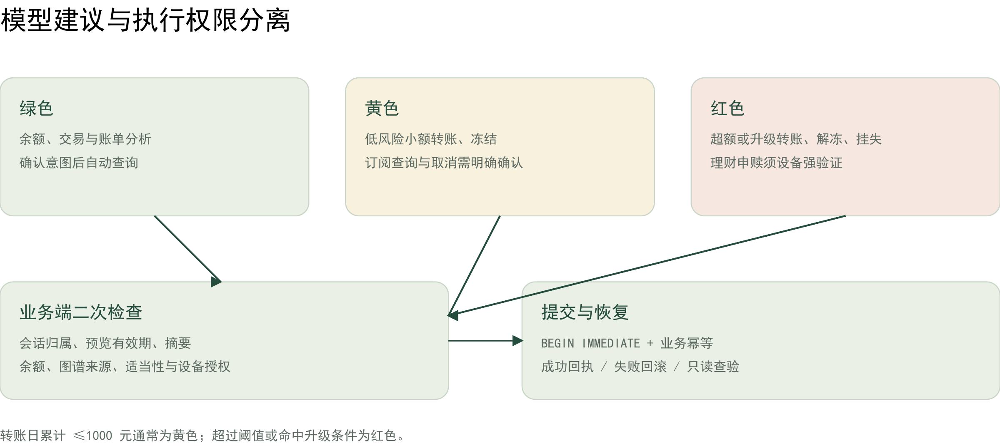

# 星河银行 AI 智能体安全自评报告

评估对象为本地竞赛原型及随包源代码，目标是在用户授权范围内执行虚构银行业务，并在异常时保留可核查的业务事实。评估日期为 2026-11-02，证据基线为 2026-11-02 已归档版本。

## 自评结论

原型已实施服务端分级授权、交易绑定设备验证、独立工作人员权限及敏感文本认证加密。内部回归覆盖 271 个测试方法，专项验证跨会话隔离与重复提交、过期授权和事务失败等边界；解压包通过 20 项运行检查。

本报告是团队自评，不是第三方认证。资金与产品为仿真，设备验证不替代实名身份。以下同时列明控制措施、实际证据和未覆盖风险，便于评委判断适用范围。

## 评估方法

通过代码核查、隔离数据库测试及故障注入，验证拒绝路径和业务副作用；浏览器走查核对页面授权与服务端状态一致。未执行真实支付、机构渗透测试或独立用户研究。

# 资产与信任边界

保护对象包括客户会话凭据、设备公钥与挑战、工作人员凭据、任务原文、账单导入内容、业务余额及审计记录。浏览器输入、模型输出和外部响应均作为不可信数据处理。

| 边界 | 控制措施 | 保留风险 |
| --- | --- | --- |
| 浏览器到业务服务 | 归属校验、摘要与状态复验 | 会话令牌遭窃后仍可能泄露该会话数据 |
| 模型到任务服务 | 结构约束、白名单、未知条件停止 | 开放语言理解仍有覆盖边界 |
| 客户到工作人员 | 独立凭据、角色与短时会话 | 本机身份不等于机构 SSO 或多租户 |
| 服务到持久化 | 事务、字段加密、审计链 | 持有进程权限及密钥者可访问明文 |
| 服务到外部来源 | 固定适配器、校验与来源说明 | 外部服务可中断或返回错误 |
| 交付到评审环境 | 文件清单、构建摘要、密钥排除 | 摘要不是可信发布者数字签名 |

本机服务绑定 127.0.0.1，设备验证来源为 localhost；不把本地 HTTP 配置直接复用到公网部署。公开部署需要 HTTPS、接入认证及额外运营控制。

任务只使用服务端固定工具与依赖，不运行用户或模型生成的脚本。其安全性质来自不开放任意代码执行；不能将此描述为已实现通用远程代码沙箱或容器隔离。

# 权限分级与认证复核

| 等级 | 业务范围 | 执行策略 |
| --- | --- | --- |
| 绿色 | 余额、交易、账单分析等查询 | 确认意图后读取记录 |
| 黄色 | 日累计不超阈值的低风险转账、冻结、订阅查询和取消 | 展示具体操作并明确确认 |
| 红色 | 日累计超过 1000 元或风险升级转账、解冻、挂失、理财申赎 | 确认后进行操作绑定设备验证 |

阈值在执行前重新计算，准备时为黄色不保证执行时仍为黄色。重复交易和关联证据变化触发拦截或重新预览；原低权限解冻记录不能绕过新策略。

## 设备验证

WebAuthn 校验挑战、签名、来源、RP 和用户验证标志，防止重放及跨来源授权。授权绑定 kind、action_id 和 digest，并在业务事务中消费。签名算法测试不等于本次进行了真人硬件操作；历史本人设备确认单独记录。

## 复核身份与职责

viewer 读取任务，reviewer 作出复核决定，auditor 读取审计，admin 管理身份。凭据按 SHA-256 存储，短时会话有效期为 15 分钟，每次请求复验身份启用状态及权限。登录具有限频，客户会话不能代替工作人员。

复核批准不产生资金变动，用户仍需主动恢复；拒绝或来源变化不能由客户自行跳过。当前角色模型未接入机构 SSO，也未实施多人双签审批。

# 敏感数据与审计保护

## 字段认证加密

使用 Fernet 对目标原文、消息、任务节点、导入账单和审计详情等配置字段认证加密，Plaid 访问令牌采用独立密钥加密。密钥从本机配置读取，不进入源码包。读取遇到缺失密钥或无效密文时停止，不把密文错误解释成空数据。

账本整数、标识符及索引仍可查询，因此不是整库文件加密。字段密文未全面绑定记录上下文，跨记录密文置换防护仍是后续加固项。掌握服务进程权限及密钥的攻击者不在该加密机制可阻止的范围内。

## 密钥与备份

初始化为新环境生成独立密钥；轮换要求服务停止并保留旧密钥以支持历史备份。数据库和密钥分别备份。密钥丢失无法通过程序恢复，Windows 文件 ACL 需由部署管理员配置，不能把 0600 创建参数视为完整 Windows 权限验收。

## 审计完整性

关键事件以每会话 SHA-256 事件链关联。事件链能发现普通篡改，但没有外部签名、可信时间戳或不可变存储；持有数据库写权限者可能重算链。报告不将其称为不可抵赖或不可篡改审计。

## 数据保留

导入与研究记录支持会话内删除，衍生证据按实现规则脱敏处理。旧备份、系统快照及外部供应商副本不属于单次本地删除范围；真实数据接入前需要单独制定保留与删除政策。

# 输入安全与外部接口故障

## 模型与提示注入

模型返回受限候选，不持有支付工具或工作人员权限。服务端重新检查联系人、金额、有效期和范围，越权指令不会变成资金授权。关系解释从核验快照编译，外部文本按数据展示；对话本身不构成办理确认。

AI 模拟发现否定与前置条件遗漏后，增加禁止表达处理、未知前提阻止编译和原子修改回滚。修复只说明已定义表达得到防护，完整多模态或所有提示注入攻击并未得到证明。

## 外部数据不可用时

Plaid 只允许 Sandbox 和指定路径，交易不进入本地可执行余额。账户身份缺失或重复、非布尔待入账状态、错误金额均拒绝同步；分页失败、限流和超时保留旧游标及成功记录。

参考汇率校验币种完整性、正有限数值、日期和带时区的获取时间。摘要一致但语义异常的缓存也不可用于报价。公开通知是来源索引，不是账户黑名单；未命中不能推导安全结论。

## 异常熔断

连续验证失败触发临时账户锁定；锁定期间执行拒绝，恢复入口仅核查记录。异常任务暂停后等待独立复核。尚未以真实攻击或用户样本量化误锁和误拦截成本。

# 事务故障验收与证据索引

| 控制目标 | 证据位置 | 实际断言 |
| --- | --- | --- |
| 重复办理 | test_banking_lifecycle_matrix.py | 四类操作同键并发仅一条完成审计 |
| 响应中断 | test_banking_journeys.py 等 | 已提交结果只读恢复，不重复扣账 |
| 跨会话访问 | 生命周期矩阵与身份测试 | 他人操作 404，凭据角色不混用 |
| 过期与策略变化 | 生命周期矩阵与契约测试 | 拒绝执行，保留账本 |
| 事务失败 | 生命周期及进程恢复测试 | 资金、状态和授权共同回滚 |
| 外部故障 | test_banking_feed_resilience.py | 限流/超时/畸形输入不覆盖旧数据 |
| 字段加密 | test_banking_storage.py | 密文读取、迁移及密钥异常拒绝 |
| 发布完整性 | test_banking_release_bundle.py | 排除敏感文件、拒绝过期构建 |

全量报告记录 271/271 方法通过，固定意图 24/24；这些是内部预定义断言，不是业务总体成功率或外部安全认证。四类矩阵本轮用转账、卡片冻结、模拟申购和订阅取消代表，并不覆盖所有操作组合。

预留/释放存在进程退出和加密备份的专项验证，不把它扩大为物理断电、全交易容灾或跨机恢复。用户试点工具已建立，当前真实外部参与者数仍为 0。

复现：python -m backend.eval.banking_release_eval --live-model。专项命令及原始报告随 TESTING.md 提供，模型凭据由评审环境自行配置；不随包分发。

# 已知风险清单与处置条件

下表按当前暴露条件评估风险，不将内部测试通过视为风险消除。等级用于整改排序，不是第三方评分；公网或真实银行部署前需重新评估。

| 风险 | 等级 | 现有措施与后续条件 |
| --- | --- | --- |
| 会话令牌被窃 | 高 | 会话归属隔离；公网前需机构身份、会话撤销和更强终端防护 |
| 机构身份与岗位 | 高 | 本机角色及短时会话；真实接入前完成 SSO、身份恢复及多人岗位分离 |
| 密钥或进程失陷 | 高 | 字段认证加密；上线前需密钥托管、ACL 与备份访问控制 |
| 开放表达遗漏 | 高 | 受限编译与停止策略；持续新题和注入攻击评估 |
| 外部模型隐私 | 高 | 默认关闭；启用会发送用户文本及合成目录，真实数据使用前需脱敏和供应商评估 |
| 审计重算或置换 | 中 | 哈希链及密文认证；上线前需外部锚定和记录上下文绑定 |
| 故障覆盖不完整 | 中 | 已有选定路径矩阵；继续跨机、断电和全业务恢复演练 |
| 移动与无障碍体验 | 中 | 桌面主流程走查；补手机、键盘、大字体及错误恢复测试 |
| 交付依赖环境 | 中 | 锁定版本与解压测试；全新机器和离线依赖安装另验 |
| 许可与真实产品接入 | 中 | 保留第三方声明；发布前复核许可，真实理财和支付须独立合规接入 |

本次提交不包含原账户数据库、真实账单、研究原始记录或本机凭据。评审使用新建虚构会话，外部接口由评审方按需配置。安全结论限定于上述版本、运行方式和已验收路径。
